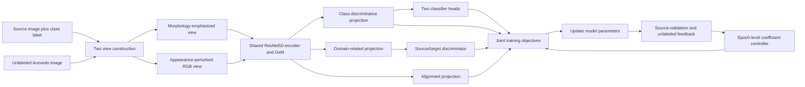
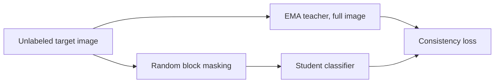
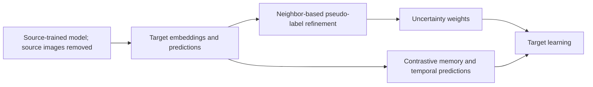
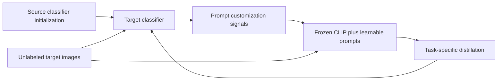
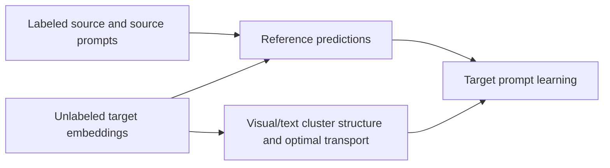

# Professor-meeting tutorial: what the experiments establish about our WBC adaptation model

**Meeting:** 27 November 2026, Korea time. **Prepared from:** the submitted main/supplementary PDFs and the completed 25–26 November experiment artifacts.

This is a teaching document, not a replacement manuscript. Read it in order once; then use the [presentation script](MEETING_SCRIPT.md) during the meeting. Original submitted documents, best-model code, checkpoints and experimental records have not been modified.

## Contents

1. [Read this first: six different sources of results](#1-read-this-first-six-different-sources-of-results)
2. [The scientific question and essential vocabulary](#2-the-scientific-question-and-essential-vocabulary)
3. [Understand the proposed pipeline before discussing its scores](#3-understand-the-proposed-pipeline-before-discussing-its-scores)
4. [The manuscript's cumulative ablation: what it can answer](#4-the-manuscripts-cumulative-ablation-what-it-can-answer)
5. [Earlier supplementary one-factor controls and the evidence discrepancy](#5-earlier-supplementary-one-factor-controls-and-the-evidence-discrepancy)
6. [Yesterday's 54-run factorial study: design and interpretation](#6-yesterdays-54-run-factorial-study-design-and-interpretation)
7. [What morphology emphasis actually means in these experiments](#7-what-morphology-emphasis-actually-means-in-these-experiments)
8. [Four exact weighting procedures, explained without labels alone](#8-four-exact-weighting-procedures-explained-without-labels-alone)
9. [A worked real epoch: sampling, training, reward and policy update](#9-a-worked-real-epoch-sampling-training-reward-and-policy-update)
10. [Direct answers to the professor's RL questions](#10-direct-answers-to-the-professors-rl-questions)
11. [Today's UDA comparison: exact protocol and results](#11-todays-uda-comparison-exact-protocol-and-results)
12. [The original papers: purpose, implementation and WBC findings](#12-the-original-papers-purpose-implementation-and-wbc-findings)
13. [Why the class-level results matter](#13-why-the-class-level-results-matter)
14. [Representation, stability and computational evidence](#14-representation-stability-and-computational-evidence)
15. [Reconcile the manuscript with the implementations](#15-reconcile-the-manuscript-with-the-implementations)
16. [What to present, what to qualify, and what to do next](#16-what-to-present-what-to-qualify-and-what-to-do-next)
17. [Likely questions and scientifically defensible answers](#17-likely-questions-and-scientifically-defensible-answers)
18. [Evidence navigation and original-paper references](#18-evidence-navigation-and-original-paper-references)

---

## 1. Read this first: six different sources of results

The most important preparation is to stop treating every number labelled **Full**, **Proposed** or **ResNet50** as the same experiment.


| Evidence family | What it contains | What it does not establish |
|---|---|---|
| Submitted main paper, Tables 1–4 | Historical primary results; cumulative removals; two backbones | Their exact reproduction from the recovered Best2 checkpoint |
| Submitted main paper, Table 5 | Historical three-seed comparison; Proposed F1 90.57/82.72/74.66 on Acevedo/Raabin/AML | A verified three-seed distribution for the single checkpoint evaluated today |
| Submitted supplement, S1–S5 | Reported one-factor, diagnostic, backbone and profiling evidence | Automatic agreement with the retained local CSVs; some numbers differ |
| Retained earlier controlled evidence | Archived CSVs behind an earlier supplementary draft | That the newly submitted, higher absolute values came from those same runs |
| 25–26 November contribution study | **54 fresh training runs:** interactions, input views, and four weighting procedures | Reproduction of the historical best checkpoint, or proof that it used learned RL |
| 26 November UDA rerun | **15 fresh baseline runs** plus read-only evaluation of **one Best2 checkpoint** | Proposed-model seed variability or identical historical selection across methods |

**Calendar clarification.** The study started at 20:14 on 25 November and finished at 08:40 on 26 November. The comparison reruns ran approximately 12:27–14:36 on 26 November. Thus “yesterday's study” crossed midnight.

The two new suites contain **69 completed top-level model-training jobs**. Source pretraining inside a baseline job is a training stage, not an additional independent replication. The 12 frozen diagnostic jobs and recovered-checkpoint evaluation do not retrain classifiers. One operationally interrupted nine-epoch source attempt was preserved and restarted; it is not a completed scientific run. Engineering smoke tests are also excluded.

This is **not** a complete count of every training run ever executed for the project: earlier studies and professor-supplied results have separate provenance.

### How to speak about a number

For every number, be able to finish this sentence:

> “This is [accuracy or macro-F1], on [which images], from [which cohort/checkpoint], using [which inference], with [which training/selection access], summarized over [how many independent models].”

That sentence prevents most accidental overclaims.

## 2. The scientific question and essential vocabulary

### 2.1 What is the domain shift here?

The prediction task remains the same five categories: **basophil, eosinophil, lymphocyte, monocyte and neutrophil**. The image distribution changes between datasets. Possible differences include specimen preparation, illumination, optics, stain appearance, resolution, cropping, patient populations and annotation practice. These are candidate explanations; these experiments do not individually identify their causal effects.

A model can recognize the source nearly perfectly while using features that do not transfer. Our plain source model illustrates this: **99.73% source F1 but 9.11% Raabin F1** under the tested recipe.

### 2.2 Four different data-access settings

| Setting | Labeled source during adaptation? | Target labels used to adapt/select? | What happens to external data? |
|---|---|---|---|
| Source-only classification | Source training only; no target adaptation | No target optimization | Final evaluation |
| Strict source-accessible UDA | Yes, alongside unlabeled target images | No | Final evaluation |
| Source-free UDA | Used to build the initial source model, then unavailable to the adaptation algorithm | No | Final evaluation |
| Historical label-informed recovered run | Source labels used; inspected script also reads source-test/target metrics for feedback/selection | **Yes in the inspected training script** | Code uses external evaluation later; broader historical human selection is not reconstructed |

**Source-free does not mean “never trained with source labels.”** It means the target-adaptation stage works from the source model and target images without source training examples.

Our model trained on SCHBC plus unlabeled Acevedo and then tested on Raabin/AML is performing **external transfer after UDA**. It is not the same training protocol as pure source-only domain generalization.

### 2.3 The fixed new-study cohort

| Data role | Dataset | Images | Allowed role in the new strict training procedures |
|---|---|---:|---|
| Source training | SCHBC | 1,102 | Images and labels enter model optimization |
| Source validation | SCHBC | 198 | Labels guide checkpoint selection/controller feedback where permitted |
| Source test | SCHBC | 329 | Final scoring |
| Adaptation target | Acevedo PBC | 750 | Images enter adaptation; labels excluded from its optimization/selection |
| External test | Raabin-WBC | 4,339 | Final scoring |
| External test | AML | 434 | Final scoring |

Exact file hashes were checked. Patient/slide IDs are unavailable, so image-level independence does not establish patient-level independence. Also, repeated inspection of an external test set can influence future design choices even without gradient updates; a revised final model should be confirmed on an untouched site.

### 2.4 Accuracy, macro-F1, seed SD and percentage points

Accuracy counts the fraction of correct predictions. Per-class F1 combines precision and recall. **Macro-F1 averages the five class F1 scores with equal class weight.** Weighted F1 is a different metric and must not be substituted for it.

Raabin contains 2,660 neutrophils (61.30%) but only 89 basophils (2.05%). Predicting only neutrophils gives 61.30% accuracy without recognizing the other classes. This is why an accuracy column alone is insufficient.

A table value **0.7266 is 72.66%**. Increasing F1 from 59.47% to 72.66% is **13.19 percentage points**, not 13.19% relative improvement.

Three-seed sample SD measures variation across three trained models, not patient uncertainty. One supplied checkpoint has **no estimable training-seed SD**; report a single value, not “±0.” Repeating its inference three times does not create three training replications.

## 3. Understand the proposed pipeline before discussing its scores

For unfamiliar terms such as GeM, CDAN, MCC, EMA, prompt learning or REINFORCE, use the [working glossary and examples](GLOSSARY.md).

### 3.1 Intended information flow



This describes a conceptual framework. Whether each operation exists in a particular checkpoint must be checked in that run's code. In particular, the inspected recovered path does not verify the submitted OD operator or a learned controller.

### 3.2 What each objective is trying to do

| Objective | Training signal | Intended role | Important limitation |
|---|---|---|---|
| Source classification | True source class labels | Preserve class recognition | Can learn acquisition-specific shortcuts |
| Source supervised contrastive | Same/different source class identities | Make same-class embeddings closer | Class labels are not anatomy annotations |
| Orthogonality penalty | Correlation between projected branches | Discourage redundant projected features | Does not prove semantic morphology/style separation |
| Domain adversarial loss | Source/target origin, not target cell labels | Reduce the discriminator's ability to separate domains | Confusion can arise from poor discrimination, not useful alignment |
| CORAL | Source/target feature covariances | Reduce second-order discrepancy | Global alignment can ignore class-conditional mismatch |
| View agreement | Two predictions of the same image | Encourage consistent decisions | Both views can agree on an incorrect class |
| Hard pseudo-label training | Model-generated high-confidence class guesses | Exploit unlabeled target images | Confidence is not correctness |
| Soft pseudo-label training | Detached target distributions | Encourage consistency with model beliefs | Wrong beliefs can reinforce themselves |
| Dynamic coefficients | Training feedback | Balance competing objectives over time | Useful implementation is not automatically useful policy learning |

The model parameters and controller parameters are different objects. Write **θ** for the encoder/classifier and **θπ** for the policy network. A loss-weight change is not automatically a θπ update.

### 3.3 Branch names are functional names

A vector called “morphology” is not known to encode only cell anatomy. The style branch can retain class information and the morphology branch can retain domain information. Probes were designed to test those assumptions instead of accepting the labels as proof.

## 4. The manuscript's cumulative ablation: what it can answer

### 4.1 Submitted Table 3, preserved as reported

| Configuration | SCHBC Acc./F1 | Acevedo Acc./F1 |
|---|---:|---:|
| Full | 98.48 / 98.47 | 93.07 / 93.07 |
| Remove self-training | 97.87 / 97.96 | 88.53 / 88.54 |
| Also remove alignment | 97.26 / 97.16 | 88.13 / 88.09 |
| Also remove adaptive optimization | 96.96 / 96.94 | 87.47 / 87.45 |
| CNN baseline | 97.57 / 97.31 | 83.87 / 84.10 |

These are manuscript-reported values. This tutorial does not claim they were reproduced by the newly recovered checkpoint.

### 4.2 Read each difference in its correct context

- **93.07→88.53:** removing self-training while the other full-model components remain changes accuracy by −4.54 pp. This is the closest row to a one-factor removal from the full model.
- **88.53→88.13:** removing alignment **when self-training is already absent** changes accuracy by −0.40 pp. It is not the effect of removing alignment from the complete model.
- **88.13→87.47:** removing adaptive optimization **after both previous groups are absent** changes accuracy by −0.66 pp. It does not isolate learned RL from a deterministic controller or a fixed schedule.
- **93.07−83.87=9.20 pp:** the complete pipeline beats that CNN reference, but the difference includes all architecture/training changes, not adaptation alone.

### 4.3 Why cumulative removal cannot identify all component contributions

Imagine an antibiotic and a treatment that makes bacteria sensitive to it. Removing the antibiotic while sensitivity treatment is present can have a large effect; removing the sensitivity treatment after the antibiotic has already gone can have a small effect. The small second difference does not mean sensitivity never mattered.

The same logic applies to pseudo-label quality, alignment and representation regularization. Their effects depend on the other active components. Cumulative differences are **path-dependent**, and changing the removal order can change them.

**What to say:** “The cumulative experiment establishes performance differences along one removal path. It motivates controlled interaction tests; it does not identify universal independent contributions.”

## 5. Earlier supplementary one-factor controls and the evidence discrepancy

### 5.1 Why one-factor controls were an improvement

A one-factor experiment compares the full model with one component disabled while retaining the others. It answers a conditional question such as:

> “Does orthogonality help when the rest of this full configuration is active?”

It still does not prove the component helps in every context, because its interactions remain fixed at one setting. Removing a term also changes optimization trajectories and the checkpoint selected by source validation.

### 5.2 A provenance issue must be resolved before using submitted S1 as verified evidence

The submitted PDF and the retained earlier CSV disagree:


| Earlier controlled configuration | Submitted S1 F1: Acevedo / Raabin / AML | Retained CSV F1: Acevedo / Raabin / AML |
|---|---|---|
| Full | 91.88 / 83.47 / 73.68 | 81.88 / 68.47 / 69.68 |
| Architecture-matched source-only | 80.71 / 63.05 / 59.62 | 80.71 / 63.05 / 59.62 |
| Without orthogonality | 78.68 / 74.73 / 62.45 | 68.68 / 59.73 / 58.45 |
| Without contrastive | 88.42 / 81.89 / 69.28 | 78.42 / 66.89 / 65.28 |
| Tied augmented inputs | 89.23 / 57.67 / 61.32 | 89.23 / 57.67 / 61.32 |
| Without agreement | 89.67 / 79.24 / 65.98 | 89.67 / 64.24 / 61.98 |
| Fixed coefficients | 85.00 / 78.18 / 67.41 | 75.00 / 63.18 / 63.41 |

Sources: submitted Supplement p. S2, Table S1; retained `supplementary_updated_20261115/evidence/main_ablation_table.csv`. A [machine-readable comparison](evidence/submitted_s1_vs_archived.csv) is included. This establishes a discrepancy, not its cause. The PDF may refer to different runs, but the matching run records have not been supplied here.

Some deltas stay identical because both compared rows differ. For example, the orthogonality Acevedo difference is 13.20 pp in both tables. That agreement does **not** verify the PDF's higher absolute scores.

Other conclusions change: the archived full model is below tied inputs and no-agreement on Acevedo, while the submitted S1 makes it higher. This changes the interpretation of the target–external tradeoff and must be discussed with the professor.

Other unresolved examples:

- Submitted S2 full grayscale scores **72.52/51.22/51.09** versus retained **62.52/41.22/41.09**.
- Submitted S4 full EfficientNet F1 **91.58/81.30/77.04** versus retained **81.58/66.30/73.04**.
- Submitted main Table 5 Proposed F1 **90.57/82.72/74.66** versus the retained earlier recent-suite summary **81.37/63.35/65.65**. The new single checkpoint is yet another evaluation.

**Meeting request:** identify the experiment folder, seed list, preprocessing and selection protocol for each submitted row. If these are professor-supplied independent runs, request their run-level metrics/predictions/configurations. Do not silently overwrite either source or assume the discrepancy's cause.

### 5.3 What the retained earlier one-factor evidence supports

Using its own full reference (**81.88/68.47/69.68**):

- Orthogonality improves means by **13.20/8.73/11.23 pp**; all three paired seeds are positive on all three domains.
- Adaptive versus fixed weighting improves means by **6.88/5.29/6.27 pp**. That compares the complete adaptive mechanism against constants; it does not isolate policy learning from predetermined rules.
- Independent augmented inputs improve external means, but reduce Acevedo versus tied inputs: **−7.35/+10.80/+8.35 pp**.
- Agreement similarly gives **−7.79/+4.23/+7.69 pp**.

This is a conditional external-transfer finding with an adaptation-target cost. The newer factorial study tests different interventions and does not need to reproduce these numerical effects.

## 6. Yesterday's 54-run factorial study: design and interpretation

### 6.1 What was changed and why

All new factor comparisons use the recovered architecture/configuration as a starting specification, a fixed image split, three seeds, and new training from ImageNet initialization. They do **not** initialize from Best2's already target-adapted weights.

If we started from an adapted model and merely disabled a loss, the features would still carry its earlier training history. That would measure fine-tuning sensitivity, not clean learning without the component.

The registered setup is: ResNet50; 224×224 input; batch eight; 35 source epochs followed by 45 adaptation epochs; AdamW; main LR 3e−5; discriminator LR 1e−5; weight decay 1e−4; frozen batch-normalization statistics; first eight **source** epochs frozen, then final 40 backbone layers eligible for fine-tuning. Checkpoint selection uses source-validation macro-F1 within each phase; the best source checkpoint starts adaptation. Final evaluation uses the best **adaptation-phase** checkpoint, not a choice between source and adapted models based on target labels.

### 6.2 The exact 18 configurations

| Block | Unique configurations added | Question |
|---|---:|---|
| OD/RGB × alignment on/off × self-training on/off | 8 | Does each group’s effect change with the others? |
| Orthogonality × source contrastive | 3 beyond the shared full reference | Are their effects dependent? |
| Grayscale+RGB, OD+OD, single RGB/shared head | 3 | Which input information or resource differences matter? |
| Rule-driven, uniform-random, policy-gradient weighting | 3 beyond the fixed reference | Does feedback or policy learning help beyond constants/noise? |
| Matched 80-epoch source-only architecture | 1 | Does target training improve over continuing source supervision? |
| **Total** | **18 × three seeds = 54 runs** | |

Alignment off removes adversarial/statistical coefficients and discriminator training. Self-training off removes hard, soft and pseudo-conditioned agreement terms. **Alignment/self-training both off is not source-only:** target agreement and target orthogonality remain. The separate 80-epoch source control has no target objective.

Orthogonality is varied during adaptation because the recovered source-pretraining step has no orthogonality term. Contrastive learning is varied during source pretraining and adaptation. These are the actual interventions, not interchangeable “remove one loss” labels.

### 6.3 How to understand an interaction

Let F(M,P) denote performance with morphology setting M and pseudo-label setting P, averaged over the other factor when specified.

The effect of pseudo-labeling with OD is `F(OD,on) − F(OD,off)`. Its effect with RGB is `F(RGB,on) − F(RGB,off)`. Their difference is an **interaction**:

$$
I_{M,P}=[F(OD,on)-F(OD,off)]-[F(RGB,on)-F(RGB,off)].
$$

If the lines below are not parallel, the pseudo-label effect depends on the view. We calculate the contrast separately per seed, then summarize those three values; we do not treat the factor cells as extra independent seed replications.


### 6.4 The OD–self-training finding

On Acevedo, averaging alignment settings:

- Pseudo-labeling with OD: **+10.03 pp**.
- Pseudo-labeling with RGB: **−4.15 pp**.
- Interaction: **+14.18 pp**; per-seed values **14.27, 14.01, 14.26**.

This is strong within-experiment consistency for a conditional relationship. It does not mean OD independently helps every dataset. OD's average factorial effect is **+0.08 on Acevedo, +1.16 on Raabin, and −9.92 on AML**; the AML effect is negative in every seed.

The design also includes alignment/self-training and three-way interactions, but their uncertainty is often large. With only three seeds and many contrasts, do not turn every positive mean into a confirmed discovery.

### 6.5 Orthogonality and contrastive learning


| Orthogonality | Source contrastive | Acevedo F1 | Raabin F1 | AML F1 |
|---|---|---:|---:|---:|
| Off | Off | 79.21 | 64.17 | 50.56 |
| Off | On | 60.58 | 63.62 | 50.84 |
| On | Off | 72.24 | 67.59 | 57.43 |
| On | On | 75.78 | 62.71 | 52.70 |

With contrastive on, orthogonality improves Acevedo by **15.20 pp**. With contrastive off, it changes Acevedo by **−6.97 pp**. Interaction: **+22.17 pp**.

**Subtle but important:** a positive interaction does not mean the combination is best. Here both-on scores 75.78, below both-off at 79.21. Orthogonality mitigates a harmful contrastive condition on Acevedo; that is different from saying every objective independently improves the model.

On Raabin, adding contrastive learning with orthogonality on costs **4.88 pp in every seed**. This contrasts with the earlier one-factor cohort's positive mean contrastive effect. The cohorts differ in input construction, controller, pseudo-label implementation and initialization protocol; an effect can genuinely change across these contexts.

### 6.6 Input controls reveal a limitation

| New-study configuration | Acevedo F1 | Raabin F1 | AML F1 |
|---|---:|---:|---:|
| OD+RGB fixed full reference | 75.78 | 62.71 | 52.70 |
| RGB+RGB fixed | 71.77 | 64.25 | 63.81 |
| Grayscale+RGB | 80.45 | 73.54 | 70.98 |
| OD+OD | 62.77 | 65.22 | 19.58 |
| Single RGB/shared classifier | 85.38 | 68.76 | 67.30 |

OD+RGB beats OD+OD on Acevedo and AML, supporting the importance of retaining RGB information. But grayscale+RGB exceeds OD+RGB on both external domains in every seed. Thus the tested OD operator is not the strongest representation in this matrix.

The single-RGB control changes shared-head capacity, consistency losses and encoder-pass count together. It cannot isolate view count by itself. OD+OD versus OD+RGB retains the two-head architecture but changes the information supplied. Grayscale versus OD is a more direct transform comparison.

## 7. What morphology emphasis actually means in these experiments

### 7.1 The registered OD operator

The detailed original manuscript supplies the structure of an optical-density/stain-like construction, but the recovered configuration did not identify all numerical constants. We registered a **new explicit operationalization**:

1. Scale RGB intensities to [0,1].
2. Compute `O = −log(I + 10⁻⁶)`.
3. Unit-normalize basis vectors `h=(0.650,0.704,0.286)` and `e=(0.072,0.990,0.105)`.
4. Form projections `H=O·h`, `E=O·e`.
5. Mix `z=0.8H+0.2E`.
6. Standardize per image and min–max map to 0–255.
7. Replicate into three channels for the pretrained encoder.

These choices were fixed before inspecting the new outcomes. They are not recovered historical settings, nucleus masks, or verified stain concentrations. Standardization followed by min–max is largely algebraically redundant; no independent benefit is claimed for those two normalization steps.


**How to read the figure:** these are actual preprocessing outputs, not evidence that nuclear/cytoplasmic semantics were correctly isolated. A transform can look visually structure-enhancing while discarding class information needed in an external domain.

### 7.2 Why grayscale is a useful control

A grayscale control asks whether the benefit comes from removing chromatic variation generally, rather than from the specific OD projection. Because grayscale+RGB performs better externally here, the present experiments do not establish that the OD-specific construction is necessary or preferable.

This does not disprove the broad research idea of morphology-aware learning. It identifies a weakness of this concrete realization. Anatomical supervision, stain-appropriate transforms or a learned structure view might behave differently, but those are future hypotheses.

### 7.3 A critical self-training implementation difference

The earlier hybrid code uses a **top-confidence quota**: with batch eight and configured fraction0.45, it rounds the maximum count to four and retains up to four eligible examples.

The recovered Best2-derived code instead computes confident coverage and gates the entire hard pseudo-label loss:

```python
mask = confidence >= 0.95
coverage = mean(mask)
hard_loss = mean_cross_entropy_over_masked_examples
hard_loss *= float(coverage <= 0.45)
```

| Batch of eight | Earlier top-confidence-quota behavior | Recovered/new-study behavior |
|---|---|---|
| Three confident images | Train on up to three | Hard loss active: coverage3/8=0.375 |
| Four confident images | Train on up to four | **Hard loss disabled:** coverage4/8=0.5 >0.45 |
| Six confident images | Retain strongest four | **Hard loss disabled** |

The soft pseudo-label loss still uses confidence-squared weights across the batch, and pseudo-conditioned agreement is not removed by that hard-loss gate. Therefore the “self-training” factorial group combines several behaviors; it is not solely a top-45%-confidence selector.

This code audit clarifies earlier shorthand in the new-study protocol: describing the setting merely as a “45% cap” is insufficient. We preserved the code and outputs rather than changing them after seeing the results. [Code evidence](CODE_EVIDENCE.md) includes the exact gate.

## 8. Four exact weighting procedures, explained without labels alone

### 8.1 Procedure A: fixed coefficients

Start with the same coefficient dictionary for every adaptation epoch:

| Actual implemented key | Initial value | Meaning |
|---|---:|---|
| classification |1.0|Source class loss|
| adversarial |0.04|Encoder domain-confusion loss|
| orthogonality |0.012|Branch-correlation penalty|
| alignment |0.07|Statistical alignment|
| morphology |0.025|Source supervised contrastive loss|

Other terms have fixed configured coefficients: source agreement0.02, target agreement0.03, pseudo-agreement0.02, hard pseudo-label0.02, and soft pseudo-label0.01 in the full reference. The registered removal factors can set specified coefficients to zero.

No feedback changes the main dictionary. No policy samples are used, and θπ has zero optimizer updates. A policy object/file may exist as unused software state; its presence is not evidence of policy learning.

### 8.2 Procedure B: predetermined feedback rules

This procedure reads source-validation F1/minimum recall, domain-discriminator accuracy and feature discrepancy, then executes explicit `if/else` multiplications.

Examples from the recovered controller family:

- Weak-class recall below thresholds increases contrastive weight by ×1.22, classification by ×1.04 and orthogonality by ×1.03.
- If the discriminator separates domains too easily (accuracy >0.62), increase adversarial weight by ×1.12 and alignment by ×1.04.
- If the scalar feedback score drops, increase classification/contrastive emphasis and reduce some adaptation weights.
- Clip every weight to predefined bounds.

In the **new strict experiment**, source-validation values occupy both historical performance slots of this rule function. No target F1 is estimated from true target labels. The source–target performance gap slot is explicitly set to zero.

In the **historical recovered script**, those slots instead receive real labeled-target and source-test metrics. These are different access assumptions despite sharing the controller class name.

The rules are adaptive, but no trainable network learns the rules. A variable named “reward” is used to trigger predetermined changes; that alone is not a policy-gradient algorithm. Its θπ-update count is zero.

### 8.3 Procedure C: uniform random coefficient changes

For each of the five keys, independently draw a factor from:

`{0.90, 0.95, 1.00, 1.05, 1.10}`, each with probability0.2.

Apply smoothing and clipping as in Procedure D below. The random coefficients are actually used in training, but no policy parameters are optimized. This tests whether coefficient variation alone produces benefits.

It is not a frozen copy of the initially untrained neural policy, whose probabilities can be nonuniform. A frozen-network/replay control would be an additional experiment to isolate learning more closely.

### 8.4 Procedure D: sampled coefficients from a trained policy

The state has six quantities:

1. Source-validation macro-F1.
2. Source-validation minimum class recall.
3. `1 − min(1, 2|domain_accuracy−0.5|)`.
4. `exp(−max(0, alignment_loss))`.
5. Pseudo-label coverage.
6. `exp(−max(0, target_view_agreement_loss))`.

The network is **6 inputs →32 tanh units →25 logits**, reshaped into **five groups of five categorical probabilities**. It has 1,049 trainable parameters. Conditional on the state, each group independently samples one factor from the same five-factor set. There are 5⁵ possible joint factor combinations; actions are not sampled from a Gaussian distribution.

For factor f and old coefficient λ:

$$
\lambda_{new}=\operatorname{clip}\big[\lambda_{old}(0.6+0.4f),\;lower,upper\big].
$$

A sampled1.10 therefore increases the coefficient by 4%, not10%. A sampled0.90 reduces it by 4%. Bounds are classification[0.8,3], adversarial[0.001,0.35], orthogonality[0.001,0.10], alignment[0.005,0.50], contrastive[0,0.20].

After training the epoch, calculate:

$$
r=0.70F1_{src,val}+0.20R_{min,src,val}+0.05C_{domain}+0.025e^{-L_{align}}+0.025e^{-L_{agreement}}.
$$

There is no true target accuracy in this reward. Coverage is a state diagnostic, not a direct reward term. Domain confusion or agreement can be achieved incorrectly, so reward improvement does not guarantee target accuracy improvement.

Use a moving reward baseline b, with 0.9 retention, and optimize:

$$
L_\pi=-(r-b)\sum_g\log\pi_{\theta_\pi}(a_g|s)-0.01\sum_g H(\pi_g).
$$

The policy uses Adam at 3e−4. The reward advantage is detached; we do not backpropagate through the whole classifier-training epoch. This is an epoch-level REINFORCE procedure with a moving baseline, not differentiable end-to-end meta-learning or a value-critic network in this new implementation.

### 8.5 The earlier hybrid controller is a fifth, different implementation

The earlier code family combines predetermined weight adjustments with small sampled residual factors, a policy network/value baseline and an adaptation warm-up. Replacing that entire mechanism with constants removes both the rule-driven prior and policy residuals. It therefore does not isolate policy learning.

Do not infer the exact update count of an archived run from the current source defaults. The original run's optimizer/history records are needed. In particular, the new135-update audit belongs to Procedure D, not to every older “RL” label in the manuscript.

### 8.6 Why the new procedure is not an exact implementation of submitted Equation1

The submitted paper says the five controlled groups are classification, representation, domain adaptation, view consistency and target self-training, with policy updates after eight adaptation warm-up epochs.

The new audited controller controls **classification, adversarial, orthogonality, alignment and contrastive** separately. View/self coefficients stay fixed. It begins in adaptation epoch 1 and makes45 updates, not an eight-epoch adaptation warm-up followed by fewer updates. Its state also differs: target prediction entropy/confidence are not separate entries.

Same number of coefficient keys does not mean same grouping. These are discrepancies to reconcile, not interchangeable descriptions.

## 9. A worked real epoch: sampling, training, reward and policy update


### 9.1 An actual sampled action, seed 42

The initial policy state is the six-vector0.5. The following heatmap shows the **actual saved probabilities**, with the sampled factor in a red rectangle.


| Key | Sampled factor | Old λ | Applied λ after smoothing |
|---|---:|---:|---:|
| classification |1.10|1.0|1.04|
| adversarial |1.05|0.04|0.0408|
| orthogonality |1.00|0.012|0.012|
| alignment |0.95|0.07|0.0686|
| contrastive |1.00|0.025|0.025|

The applied dictionary is converted to tensors and supplied to every one of the epoch's138 adaptation minibatches. The model optimizer uses those tensors inside its total loss. The saved `consumed` record matches the action's applied values.

### 9.2 The coefficients really enter the loss

The first adaptation epoch has mean total loss approximately **0.427647**. Its logged weighted terms reconstruct that total to about **1.52×10⁻⁸** absolute error.


Classification contributes approximately 73.61% of that scalar total; adversarial7.09%, source contrastive5.61%, and target agreement7.60%. The alignment term is around9×10⁻⁸ despite an alignment coefficient of 0.0686.

This teaches two things:

1. The coefficients are actually consumed; they are not merely plotted after training.
2. A large coefficient does not imply a large effective loss contribution. Scalar loss contribution is also not the same as a parameter-gradient norm. Per-objective gradients would be needed to quantify optimization influence more directly.

### 9.3 The feedback update changes θπ

After the epoch, the saved proxy reward is approximately 0.948685. The first centered advantage is zero because the moving baseline is initialized to that reward; the entropy term can still update policy parameters. The saved first update has nonzero gradient norm and parameter change.

Subsequent updates use differences from the moving baseline. Their new action distributions generate coefficients consumed by later model epochs. The terminal update after epoch 45 has no subsequent classifier epoch.


Do not use a reward curve alone as proof. The convincing evidence is the combination of sampled probabilities, selected actions, actual consumed coefficients, optimizer iteration count, nonzero parameter delta and the matching loss reconstruction.

## 10. Direct answers to the professor's RL questions

### Question 1: “No RL training results are reported. How many training runs were executed?”

**Answer for the new study:**54 completed classifier-training runs across18 configurations; only one configuration uses Procedure D, repeated over **three seeds**. Those three are the independent learned-policy training runs. Today's15 baseline runs add no loss-policy updates. A claim about the historical primary run requires its own policy records.

### Question 2: “How many times was θπ updated?”

| New condition | Model runs | Sampled action vectors | Actual θπ optimizer updates |
|---|---:|---:|---:|
| Fixed reference |3|0|0|
| Predetermined feedback rules |3|0|0|
| Uniform random factors |3|135|0|
| Trained categorical policy |3|135|135|

Each policy action vector contains five categorical selections:675 selections across the learned-policy runs. The combined270 action vectors in the audit include135 **random-control** vectors and must not be called270 learned-policy actions.

Every learned run has 45 updates. The first has zero centered reward advantage and an entropy update; the other44 have nonzero logged reward advantages. Only the first44 update boundaries per run can influence later classifier training within the recorded schedule; the last is terminal. Optimizer calls, reward-informed updates and updates followed by further model training are distinct counts.

Across51 adaptation configurations/seeds ×45 epochs, **2,295 epoch-level coefficient-consumption records** were verified. The three source-only runs have no adaptation epochs.

### Question 3: “From what distribution were actions sampled?”

From the product of five state-conditional categorical distributions output by the 6→32→25 network. Each group chooses among0.90/0.95/1/1.05/1.10. The full probability matrices are saved; the learned probabilities are neither fixed uniform nor Gaussian. The separate random control is uniform.

### Question 4: “Were the lambdas used again when training Ltotal?”

**Yes in the new audited implementation.** The action at the epoch boundary produces coefficient tensors used inside the encoder/classifier loss for 138 batches. Feedback from that epoch trains the policy; the next action then determines the following epoch's coefficients. The action/consumption equality and reconstructed total loss verify the connection.

The historical deterministic recovered code also has an epoch-level feedback path, but it is **not policy-gradient learning**, and its feedback uses labeled-target/source-test metrics. These are different issues: the loop can be closed without a learned policy.

### Question 5: “Does this prove RL improves the model?”

No general superiority is established:

| Procedure, OD+RGB context | Acevedo F1 | Raabin F1 | AML F1 |
|---|---:|---:|---:|
| Fixed |75.78 ±6.46|62.71 ±0.90|52.70 ±7.76|
| Predetermined feedback rules |64.68 ±19.98|69.11 ±7.20|55.84 ±6.78|
| Uniform random coefficient changes |72.76 ±9.25|66.22 ±4.52|52.19 ±6.54|
| Trained categorical policy |62.78 ±13.87|66.17 ±0.32|57.58 ±9.19|

Learned weighting improves the external means versus fixed weighting, but loses13.00 pp on Acevedo. Raabin is essentially equal to uniform-random weighting, and lower than the rule-driven mean. AML improves versus both, but with considerable seed variation.

Compared with the **matched source-only architecture** (81.30/60.94/46.61), the trained policy gives **−18.53/+5.23/+10.97 pp**. All three seeds improve both external domains but lose on Acevedo. This supports an external-transfer tradeoff; it does not isolate a universal benefit from policy learning.

**Meeting sentence:** “We can now demonstrate policy optimization and the closed loop. Its comparative performance remains conditional, so implementation proof and contribution proof must be reported separately.”

## 11. Today's UDA comparison: exact protocol and results

### 11.1 What was repeated?

Five methods were trained independently for seeds42–44: source-only ResNet50, MIC, PLUE, DIFO and CRPL. The recovered Best2 checkpoint was loaded read-only and evaluated once. It was not injected into source-free baselines: that would give them an already target-adapted model and invalidate their intended initialization.

The primary geometry is RGB resize256×256, center crop224×224 at evaluation, no TTA. Standard training uses random224 crops and horizontal flips; model-specific strong views remain. CLIP retains its required preprocessing/normalization. Proposed also has separately exported native224-resize and five-view results.

| Method | Source/adaptation procedure | Selection | Resources |
|---|---|---|---|
| Source-only |80 source epochs; GAP/linear five-class head; SGD backbone0.001/head0.01; momentum0.9; smoothing0.1 |Best source-validation F1 |Torchvision ImageNet ResNet50 |
| MIC |35 source +45 adaptation epochs,138 adaptation updates/epoch; masked consistency with author SDAT recipe |Source-validation F1 |Torchvision ResNet50, EMA teacher/discriminator/SAM optimizer |
| PLUE |Own35-epoch source model, then45×138 target updates |Source initialization selected on source validation; adaptation fixed final |Author ResNet50/AdaMoCo; source-free adaptation |
| DIFO |Own35-epoch source model, then45×138 adaptation updates |Source-validation initialization; final adaptation checkpoint |ResNet50 plus CLIP ViT-B/32 and prompt tuning |
| CRPL |6,210 joint prompt updates, batch8 |Author source-loss-valley text-feature averaging, final fallback |CLIP-RN50; source-combined adaptation |
| Proposed |Existing recovered checkpoint |Historical target-balanced/label-informed procedure |Keras ResNet50, GeM, projected branches/two heads |

The source-free ports have observer-only source-validation diagnostics for plots; those numbers do not enter their adaptation loss, hyperparameter decisions or final selection. This is distinct from giving the adaptation algorithm source labels. If demonstrating a strict “no source file is opened at all” execution requirement, replay stored checkpoints for observer diagnostics after training instead.

The batches are not perfectly identical: the TensorFlow source loader retains its last incomplete batch; PyTorch training drops it. Head architectures, optimizers, warm-up rules, trainable layers and pretraining implementations differ. These are declared WBC budget ports, not exact reproductions of the authors' original benchmark scores.

### 11.2 The complete primary table


For easier reading, macro-F1 percentages are:

| Method | Source | Acevedo | Raabin | AML |
|---|---:|---:|---:|---:|
| Source-only |99.73 ±0.23|54.28 ±7.30|9.11 ±5.96|47.19 ±2.82|
| MIC |99.29 ±0.84|97.06 ±1.97|28.55 ±13.92|58.02 ±19.82|
| PLUE |90.45 ±0.56|92.62 ±1.26|59.47 ±1.87|70.18 ±3.96|
| DIFO |41.53 ±10.98|47.60 ±5.44|16.54 ±4.51|26.00 ±6.44|
| CRPL |62.11 ±8.13|50.71 ±1.84|34.41 ±3.08|36.45 ±3.05|
| Proposed: **one checkpoint** |97.91|91.40|72.66|68.71|


Your checkpoint's clearest strength is Raabin: **84.84% accuracy,72.66% F1**, exceeding all baseline seeds. It is 5.65 pp below MIC on Acevedo and 1.46 pp below PLUE's mean on AML. These are descriptive score differences, not paired proposed-seed significance tests.

### 11.3 “Same dataset” is only one layer of fairness

A comparison should separately declare: identical file identities/classes; label access; initialization/pretraining; encoder/head resources; preprocessing; optimizer/budget; selection; inference; and replication. We share some of these and explicitly differ in others.

Most importantly, the recovered script's target-balanced selection uses real target/source-test metrics. That cannot be undone by evaluating its final predictions with a clean evaluator. The strong Raabin score is real for this supplied checkpoint, but it is not proof of superiority under identical strict-UDA selection.

## 12. The original papers: purpose, implementation and WBC findings

These are general adaptation methods, **not original WBC-classification papers**. We selected them to test complementary mechanisms on our five-class task. Their published original benchmark numbers are not WBC baselines; the numbers here are our local ports.

### 12.1 MIC — masked image consistency, CVPR2023

**Original mechanism.** MIC uses an exponential-moving-average teacher to predict a complete target image. A student sees a randomly masked version and is trained for prediction consistency, encouraging use of surrounding context. It is a module that can be combined with different UDA algorithms and tasks, including classification. We use its classification/SDAT path, not its semantic-segmentation architecture. [Original paper](https://openaccess.thecvf.com/content/CVPR2023/papers/Hoyer_MIC_Masked_Image_Consistency_for_Context-Enhanced_Domain_Adaptation_CVPR_2023_paper.pdf).



**Why compare it?** Our model also uses consistency across views, but adds proposed representation/objective mechanisms. MIC is a strong test of whether a different consistency strategy adapts effectively.

**What our port executes.** Author classification training, CDAN/MCC components, masking, EMA and the SAM optimizer; a compatible torchvision feature-map wrapper and fixed WBC budget. Here **SAM means Sharpness-Aware Minimization**, not the Segment Anything Model. MIC continues using labeled source batches during adaptation.

**Observed strength.** Acevedo97.06 F1, above every proposed comparison score in the primary setting. Its own source-reference Acevedo F1 rises62.49→97.06.

**Observed weakness.** Raabin28.55 F1 and high external seed variation. AML seed F1 ranges36.48–75.51. Its target success does not guarantee transfer to a different acquisition domain. We have not isolated masking as the cause of that limitation.

### 12.2 PLUE — uncertainty-guided pseudo-labeling, CVPR2023

**Original mechanism.** PLUE adapts a source model without source images. It refines pseudo-labels using neighboring target examples, estimates their uncertainty to reweight supervision, and regularizes target embeddings through contrastive learning. A temporal prediction mechanism helps exclude likely same-class examples from negative pairs. Its aim is to reduce the damage from noisy pseudo-labels. [Original paper](https://openaccess.thecvf.com/content/CVPR2023/papers/Litrico_Guiding_Pseudo-Labels_With_Uncertainty_Estimation_for_Source-Free_Unsupervised_Domain_Adaptation_CVPR_2023_paper.pdf).



**Why compare it?** Confidence/noise management is central to our self-training. PLUE provides a stronger pseudo-label mechanism under a stricter source-free constraint.

**What our port executes.** Author ResNet/AdaMoCo, training/refinement/uncertainty/negative-pair functions, transferred to five classes and batch8. Target ground truth is replaced by unavailable labels. Our adapter initializes a target bank and updates it online; it does not reproduce every original full-epoch bank refresh/evaluation convention. Final scoring uses direct classifier predictions, not a newly selected neighbor-refined inference rule. The budgets and ImageNet weak-view normalization also differ from original benchmark settings.

**Observed strength.** The best balanced comparator:92.62 Acevedo,59.47 Raabin,70.18 AML F1; small external SDs. Relative to its own source initialization, all seeds improve all three target/external domains.

**Observed weakness/tradeoff.** Source F1 declines99.55→90.45. It trails our fixed checkpoint on four Raabin classes, but improves AML monocyte recognition. Do not describe it as uniformly weaker.

### 12.3 DIFO — distilling a multimodal foundation model, CVPR2024

**Original mechanism.** DIFO addresses source-free adaptation using a source model and a frozen multimodal foundation model. It alternates task-specific prompt customization and transfer of the customized foundation-model knowledge into the target classifier. Its objective includes regularization to encourage likely categories and prediction consistency. The purpose is to obtain task-relevant guidance beyond a noisy source model alone. [Original paper](https://openaccess.thecvf.com/content/CVPR2024/papers/Tang_Source-Free_Domain_Adaptation_with_Frozen_Multimodal_Foundation_Model_CVPR_2024_paper.pdf) · [Author project](https://www.taulab.cc/proj/sfda/cvpr24/difo/index.html).



**Why compare it?** It tests whether additional image–text pretraining and prompt-guided distillation outperform our source-accessible architecture on WBC transfer. Its extra resources must be visible.

**What our port executes.** Author ResNet/bottleneck/head, target-training and prompt-tuning functions, with CLIP ViT-B/32, hidden target labels and fixed WBC updates. Dataset wrappers, caches and output paths were adapted to our files. It is not initialized from Best2.

**Observed strength/limited success.** It slightly improves mean Raabin F1 over its own source initialization13.84→16.54.

**Observed weakness.** Source F1 degrades99.26→41.53; Acevedo49.97→47.60; AML44.74→26.00. This is a serious adaptation failure of the tested configuration, not evidence that the original paper or foundation-model adaptation generally fails. Learning-rate/prompt/pseudo-label/implementation assumptions need further diagnosis before making broad claims from this row.

### 12.4 CRPL — preserving clusters in prompt learning, CVPR2025

**Original mechanism.** CRPL uses CLIP embeddings and prompt learning for UDA. It strengthens target-prompt learning using source-prompt reference predictions and the geometry of visual/text embeddings. An optimal-transport formulation promotes cluster-preserving relationships between visual features and text representations, rather than relying only on generic zero-shot pseudo-labels. [Original paper](https://openaccess.thecvf.com/content/CVPR2025/papers/Vuong_Preserving_Clusters_in_Prompt_Learning_for_Unsupervised_Domain_Adaptation_CVPR_2025_paper.pdf).



**Why compare it?** Our method claims complementary structured representations. CRPL tests a recent alternative that structures adaptation in a pretrained image–text/prompt space.

**What our port executes.** Author source-combined training, PromptGenerator, optimal transport and source-loss-valley feature averaging, restricted to one source→Acevedo direction. It uses CLIP-RN50, not ordinary ImageNet ResNet50. An uninitialized combined-source prompt buffer was initialized consistently with other prompts, and evaluation feature averaging was detached to avoid retained graphs. These repairs are disclosed.

**Observed strength.** Seed variation on external scores is smaller than MIC's, but modest variance is not sufficient when the mean is low.

**Observed weakness.** Source62.11, Acevedo50.71, Raabin34.41, AML36.45 F1 show limited WBC task discrimination under this port. This is not only failure to transfer from a well-solved source task. Its original classification descriptions/resources/budget differ, so avoid claiming the paper's original benchmarks were disproved.

### 12.5 Why the older DANN/CORAL/MCD results still have a role

They are historical mechanism baselines, not the fresh recent-method rows above:

- **DANN:** source classification plus a domain adversary/gradient reversal encourages features that confuse domain origin. Relevant to our adversarial term. [Original JMLR paper](https://jmlr.csail.mit.edu/papers/v17/15-239.html).
- **Deep CORAL:** aligns second-order activation statistics while preserving source classification. Relevant to our statistical alignment term. It is associated with the ECCV2016 TASK-CV workshop, not a recent CVPR main-conference paper. [Original preprint](https://arxiv.org/abs/1607.01719) · [Author lab description](https://ai.bu.edu/projects.html).
- **MCD:** two classifiers are trained to expose target decision-boundary discrepancy, then the feature extractor reduces it. Our two-head agreement is not the same min–max procedure. [Original CVPR2018 paper](https://openaccess.thecvf.com/content_cvpr_2018/papers/Saito_Maximum_Classifier_Discrepancy_CVPR_2018_paper.pdf).

Older results should remain explicitly historical and use their original data/selection description. Do not mix their numbers with the new checkpoint row or infer that “two heads” means the architectures/optimization are equivalent.

## 13. Why the class-level results matter


### 13.1 What drives the Raabin advantage over PLUE?

| Class | Proposed F1 | PLUE mean F1 | Difference pp |
|---|---:|---:|---:|
| Basophil |69.64|48.89|+20.75|
| Eosinophil |54.36|30.30|+24.06|
| Lymphocyte |90.93|74.40|+16.53|
| Monocyte |57.75|58.94|−1.19|
| Neutrophil |90.61|84.80|+5.81|

The advantage spans rare and common classes. However, only 95/234 monocytes are found (40.60% recall), and 76 are predicted as lymphocytes. All95 monocyte predictions are correct (100% precision), so the model is conservative in assigning this class.

Raabin eosinophil recall is 82.30%, but precision40.58%. In particular,339 neutrophils become eosinophils. A high recall or overall accuracy does not mean the category is reliably recognized in both directions.

### 13.2 Why AML does not lead

AML monocyte F1 is 51.24 versus PLUE68.09. Only31/88 monocytes are correct (35.23% recall);38/88 are assigned to basophils. Monocyte precision is 93.94%, again showing infrequent but mostly accurate assignments.

Our checkpoint improves AML basophil F1 over PLUE (55.77 versus44.80) but loses enough on monocytes to reduce overall macro-F1. A useful discussion must show both effects rather than only classes where we win.

### 13.3 What the matrices cannot explain

The counts identify which decisions fail. They do not prove whether stain variation, nuclear structure, overlapping morphology, class priors or label conventions cause the error. Those need paired image/feature analysis or additional annotations.

## 14. Representation, stability and computational evidence

### 14.1 Whole-test metrics versus diagnostic panels

The frozen studies use32 images per class per domain:160 images/domain, with different prevalence from the full test. Do not replace whole-test Raabin F1 with its higher balanced-panel result. Macro-F1 can also change when class prevalence changes because precision changes.

The new fixed-OD panel Raabin F1 is 74.04, while whole-test F1 is 62.71. Both can be correct. They measure different evaluation distributions.

### 14.2 Color tolerance and spatial dependence

On the new Raabin panel, channel-gain perturbation changes fixed-OD F1 from 74.04 to approximately 74.04; RGB changes74.75→70.07. This supports robustness to that specific appearance change.

But AML fixed-OD changes53.23→45.06, so robustness is not universal. Tile disruption drops OD74.04→6.67 and RGB74.75→6.67 on Raabin. Both rely on spatial organization; neither result alone identifies anatomical features uniquely used by the OD model. Tile scrambling is destructive and not assumed label-preserving.

### 14.3 What feature probes show

Source-trained linear probes ask whether source class information transfers through a frozen feature branch. Domain probes ask whether dataset identity remains decodable within each cell class, with four-domain chance25%.

In the new study, morphology-branch domain accuracy is 93.07% for fixed OD,92.60% for trained weighting, and 84.48% for RGB. Strong domain decodability remains. Morphology/style CKA is also high, e.g.0.964 on Acevedo and 0.961 on AML for fixed OD.

The new probes use **view-A features**; final classification averages both views. The OD view-A morphology probe's AML F1 is 22.55 versus65.82 for RGB. This is consistent with a transfer limitation under that linear-probe protocol, not proof that no decoder could recover useful information.

### 14.4 What stability curves do and do not show


These are source-validation trajectories, not target/external learning curves. High stable source F1 cannot establish good external transfer: the plain source classifier is the clearest counterexample. The recovered checkpoint has no new three-seed trajectory, and the 54-run cohort's stability must not be assigned to it.

The learned controller has Raabin SD0.32 but Acevedo13.87 and AML9.19. It is not uniformly stable. Baseline PLUE's external SDs1.87/3.96 are smaller than MIC's13.92/19.82, but Proposed's seed variability remains unknown.

### 14.5 Cost and backbone claims

The new fixed OD study averages13.81 minutes training; learned weighting13.99; matched source-only 7.81; single RGB8.64. Those include different training operations and do not establish an efficiency advantage.

The submitted S5 latency values3.24ms versus3.05ms and the archived backbone profiles belong to earlier inference implementations. They cannot be automatically assigned to the new OD/RGB two-pass implementation or today's checkpoint. The new54-run study uses one backbone; it does not establish backbone independence. Resolve S4's numerical provenance before using its reported larger gains.

## 15. Reconcile the manuscript with the implementations

| Manuscript statement/location | Available implementation/evidence | Required interpretation |
|---|---|---|
| Main §3: OD morphology view | New explicit OD operator exists; recovered path does not verify historical operator/constants | Separate intended method from verified historical execution |
| Main Eq.1: five grouped controlled objectives | New controller's five keys have a different grouping; view/self are fixed | Do not claim exact equation-level controller reproduction |
| Main §3: eight adaptation warm-up epochs | New trained policy acts/updates from adaptation epoch 1 | Report new schedule; source backbone warm-up is a different event |
| Main §3: entropy and balance terms in self-training | Recovered config gives these coefficients zero | Included mathematical terms are not necessarily active in this run |
| Main §3/§4: target labels excluded from feedback/selection | Inspected recovered script feeds target/source-test metrics into its controller/selection | New strict runs and historical checkpoint have different access assumptions |
| Main Table5: Proposed mean±SD over three seeds | Today's Proposed row contains one checkpoint | No borrowed SD or triple inference repetition |
| Main Table5: highest means on both external sets | Today's Proposed leads Raabin; PLUE has higher AML mean | Scope statements to the exact table/cohort |
| Supplement S1/S2/S4 numerical values | Retained CSVs disagree for several rows | Request matching run-level evidence; do not silently reconcile |
| Supplement: grayscale is diagnostic | Correct distinction | Keep grayscale perturbation separate from training an OD view |
| Supplement: independent views/tied controls | Earlier identical augmented pixels differ from new OD+OD independently augmented inputs | These are different ablations |
| Supplement: fixed removes controller/heuristic together | Earlier hybrid family supports this caveat | Use new separated procedures for a more direct test |

The new best checkpoint’s higher performance than some controlled variants does not make those variants invalid. The variants test newly specified operations under a strict protocol; the checkpoint has a different input/training/selection history. Conversely, its predictive success does not prove every proposed mechanism was implemented or beneficial.

## 16. What to present, what to qualify, and what to do next

### 16.1 Three defensible findings

1. **Predictive performance:** the recovered checkpoint has a strong Raabin result relative to the tested recent ports; it is competitive but not best on AML, and MIC is best on Acevedo.
2. **Mechanism dependence:** the new factorial experiment finds a reproducible Acevedo OD–self-training interaction and orthogonality–contrastive dependence, with important external losses.
3. **Auditable control:** the new policy implementation genuinely samples, trains and feeds coefficients back into model training. Its general superiority over nonlearned weighting is not established.

### 16.2 Three questions to resolve before strengthening claims

1. Which run directories/predictions support the submitted higher S1/S2/S4 and main Table5 Proposed values?
2. Which exact morphology/controller/pseudo-label implementation generated each primary checkpoint?
3. Which proposed checkpoints satisfy target-label-free feedback and selection, and how many independent seeds exist for that exact protocol?

### 16.3 Prioritized scientific next steps

- Reconcile the existing evidence first. New scores cannot explain missing provenance for submitted scores.
- Reproduce the intended historical architecture/input pipeline in three strict-UDA seeds, preserving exact code/configuration/selection traces.
- Compare the registered OD transform with grayscale, RGB and a validated anatomy-aware alternative on a separate development protocol. Confirm changes on an untouched site.
- Add a stronger source-only recipe matched in architecture/augmentation/optimizer, because the plain source baseline is extremely weak externally.
- For policy attribution, add a frozen-initial-network or coefficient-replay control and report per-objective gradient magnitudes, not only coefficient values.
- Investigate monocyte recall and the neutrophil→eosinophil/basophil error flows; report calibration and class-wise pseudo-label coverage prospectively.
- Add independent transfer directions and patient/slide grouping where possible. One adaptation target plus two repeatedly inspected external sets does not cover the field's generalization problem.

### 16.4 A balanced explanation of the contribution

> “The work combines complementary views and representation/adaptation objectives to address acquisition shift. The current evidence indicates that these components interact: gains in one context can have costs elsewhere. The recovered model is particularly strong on Raabin, while the new controlled study identifies weaknesses of the registered OD implementation and limitations of policy-learning benefits. We now have direct evidence that the new policy feedback loop is implemented, and we have a concrete plan to reconcile historical provenance and strengthen the mechanism claims.”

## 17. Likely questions and scientifically defensible answers

**Q: Does a negative OD effect mean morphology-aware learning is useless?**  
No. It limits claims about this operator. The broader hypothesis requires a validated structural representation and independent confirmation. We should not rename a negative result as a positive contribution.

**Q: Why can a positive interaction coexist with a weak full model?**  
Interaction measures how one component changes another's effect. It does not require the joint configuration to beat every alternative; our orthogonality/contrastive table demonstrates that directly.

**Q: Why did the older one-factor experiment say a component helps but the new study says otherwise?**  
The older and new interventions differ in inputs, weighting mechanism, pseudo-label implementation and training path. A conditional effect can change. First resolve the submitted-versus-archived numerical discrepancy, then compare explicitly defined conditions.

**Q: Can we claim the historical model trained a policy because new runs did?**  
No. The new135-update evidence belongs to the new controller. The recovered controller is deterministic in the inspected code. A learned-policy claim for a different historical model needs that model's own records.

**Q: Could lambdas be computed without affecting training?**  
Yes in principle, which is why plots alone are insufficient. In our new trace, action outputs match consumed coefficient tensors, the model optimizer takes batch steps, and weighted terms reconstruct the actual loss. That closes the evidence chain.

**Q: Is changing weights automatically reinforcement learning?**  
No. Predetermined rules can change weights. Here policy learning specifically means optimizing a parameterized action distribution using logged reward/log-probability gradients.

**Q: Why does the learned policy not consistently beat random weighting?**  
We have only three policy trajectories and 45 decisions per run, a source/unlabeled proxy reward, and a nonstationary classifier environment. These are plausible limitations, not proven causal explanations. The evidence currently supports implemented learning, not an optimized policy.

**Q: Are source-free methods truly source-free if a plot shows source validation?**  
The adaptation algorithms receive only target images and their source initialization. Observer metrics are not used by loss, tuning or selection. A stricter execution demonstration can compute those curves afterward from saved checkpoints.

**Q: Are MIC and PLUE weak because they are generic computer-vision methods?**  
The results do not support that broad statement: MIC is best on Acevedo and PLUE best on AML. Their adaptation mechanisms are relevant, but their original numerical benchmark scores are not WBC results.

**Q: Does high domain-probe accuracy mean the classifier necessarily uses domain shortcuts?**  
No. It shows information is decodable, not that it causes the decisions. It does prevent calling the representation demonstrably domain-invariant from these probes alone.

**Q: Why not present the best inference setting separately for each dataset?**  
That selects the protocol using test outcomes and makes a mixed row hard to interpret. Keep one predefined primary setting; show all alternatives as sensitivity evidence.

**Q: Can we use SD from the old three-seed table for today's checkpoint?**  
No. Different model realizations and protocols require their own replication. A single checkpoint has no trained-seed SD.

**Q: What should we say if asked about the submitted higher supplementary values?**  
“We identified a mismatch with the retained archived table and are tracing the matching run evidence. We will not claim those particular absolute values are reproduced by the available artifacts.” Ask the professor for the actual supporting run folders rather than guessing.

**Q: What is the strongest current sentence about superiority?**  
“The recovered checkpoint exceeds every tested baseline seed on Raabin under the declared evaluation, while MIC leads Acevedo and PLUE has the higher AML mean; source access/resources/historical selection differ.”

**Q: What remains before a strong causal morphology/RL claim?**  
Exact implementation provenance, independent target-label-free replications, matched controls and additional anatomical/transfer confirmation. More tables alone cannot replace those conditions.

## 18. Evidence navigation and original-paper references

### Local, portable evidence included in this folder

- [Submitted main PDF text extraction](evidence/submitted_main_extracted.txt) and [supplement extraction](evidence/submitted_supplement_extracted.txt).
- [Archived one-factor table](evidence/archived_one_factor_table.csv), [backbone table](evidence/archived_backbone_table.csv), and [S1 reconciliation](evidence/submitted_s1_vs_archived.csv).
- [New factorial summary](evidence/factorial_summary.csv), [contrasts](evidence/factorial_contrasts.csv), [controller audit](evidence/controller_audit.csv).
- [Actual seed 42 action/consumption/update trace](evidence/actual_learned_controller_trace_seed42.json).
- [UDA summary](evidence/uda_summary.csv), [per-class evidence](evidence/uda_per_class.csv), [own-source pre/post changes](evidence/uda_before_after.csv).
- [Code excerpts with original line numbers](CODE_EVIDENCE.md).
- Each new schematic/statistical plot is provided in PNG for GitHub and PDF for reuse; [figure list](FIGURES.md).

### Original-paper and author-code links

| Method | Original paper | Author implementation |
|---|---|---|
| MIC | [CVPR2023](https://openaccess.thecvf.com/content/CVPR2023/papers/Hoyer_MIC_Masked_Image_Consistency_for_Context-Enhanced_Domain_Adaptation_CVPR_2023_paper.pdf) | [lhoyer/MIC](https://github.com/lhoyer/MIC) |
| PLUE | [CVPR2023](https://openaccess.thecvf.com/content/CVPR2023/papers/Litrico_Guiding_Pseudo-Labels_With_Uncertainty_Estimation_for_Source-Free_Unsupervised_Domain_Adaptation_CVPR_2023_paper.pdf) | [Author repository](https://github.com/MattiaLitrico/Guiding-Pseudo-labels-with-Uncertainty-Estimation-for-Source-free-Unsupervised-Domain-Adaptation) |
| DIFO | [CVPR2024](https://openaccess.thecvf.com/content/CVPR2024/papers/Tang_Source-Free_Domain_Adaptation_with_Frozen_Multimodal_Foundation_Model_CVPR_2024_paper.pdf) | [tntek/source-free-domain-adaptation](https://github.com/tntek/source-free-domain-adaptation) |
| CRPL | [CVPR2025](https://openaccess.thecvf.com/content/CVPR2025/papers/Vuong_Preserving_Clusters_in_Prompt_Learning_for_Unsupervised_Domain_Adaptation_CVPR_2025_paper.pdf) | [Author repository](https://github.com/VuongLong/Clustering-Reinforcement-Prompt-Learning) |

Original paper mechanisms were checked against the available paper PDFs and primary CVF/author sources. Method-specific WBC implementation statements refer to the retained adapters, not unmodified reproductions of original benchmark training. All WBC numbers in this tutorial are explicitly labelled as reported historical values or our local experimental results.
